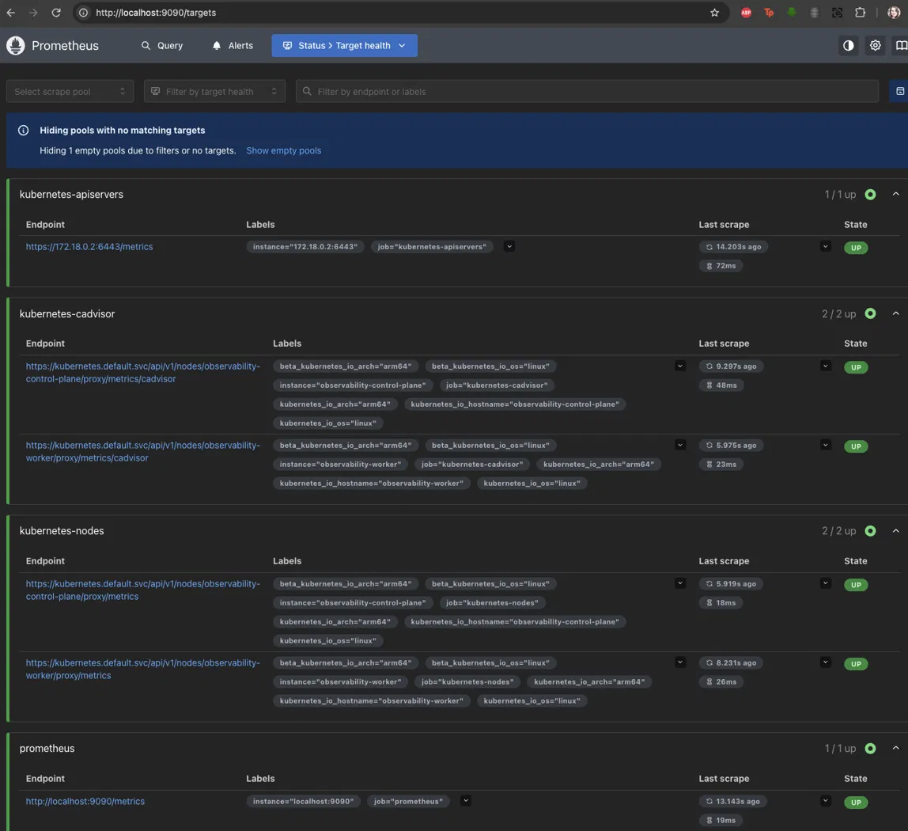
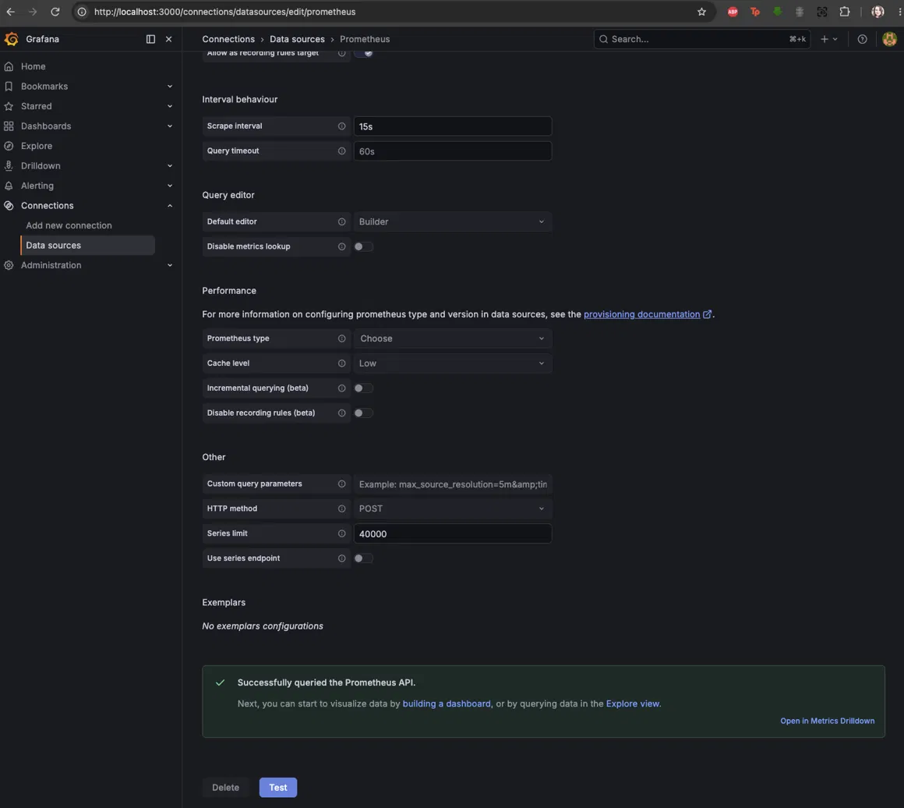
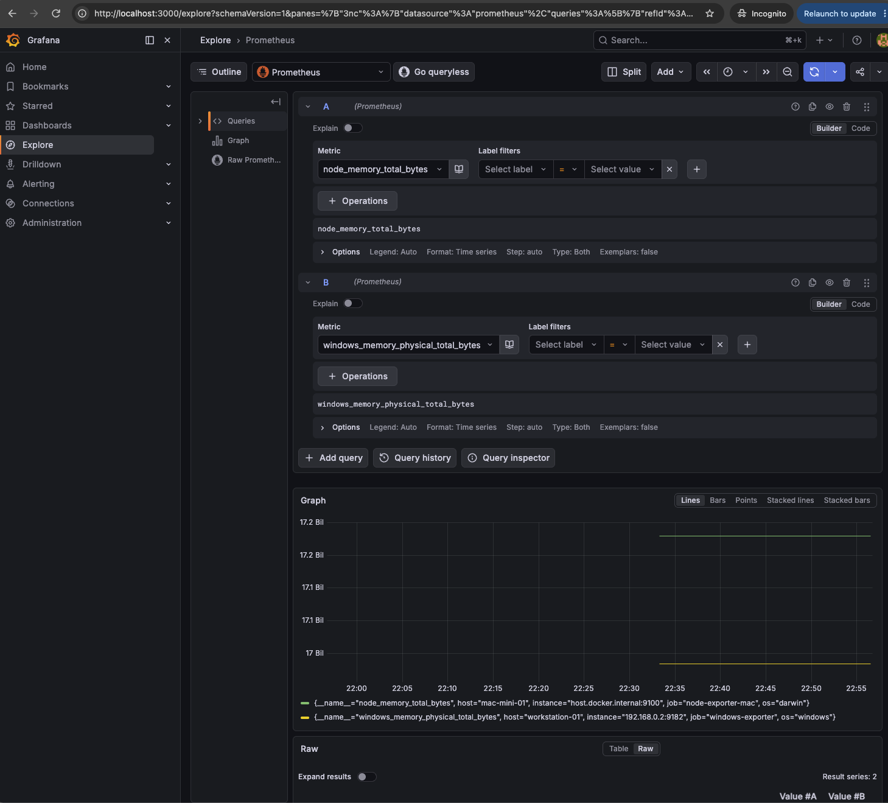
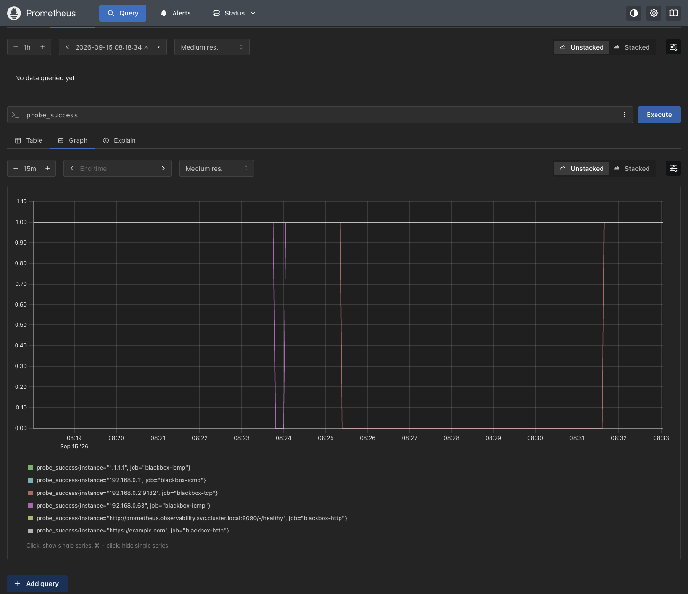
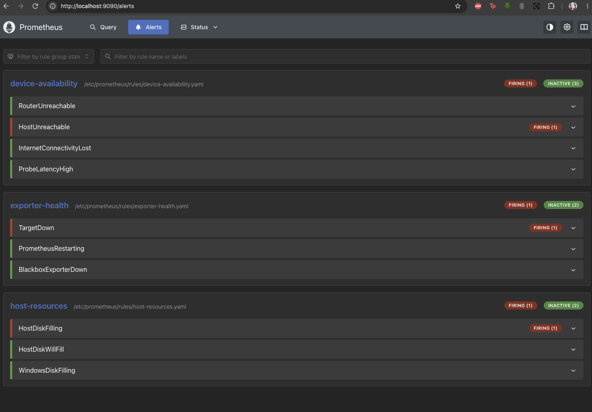
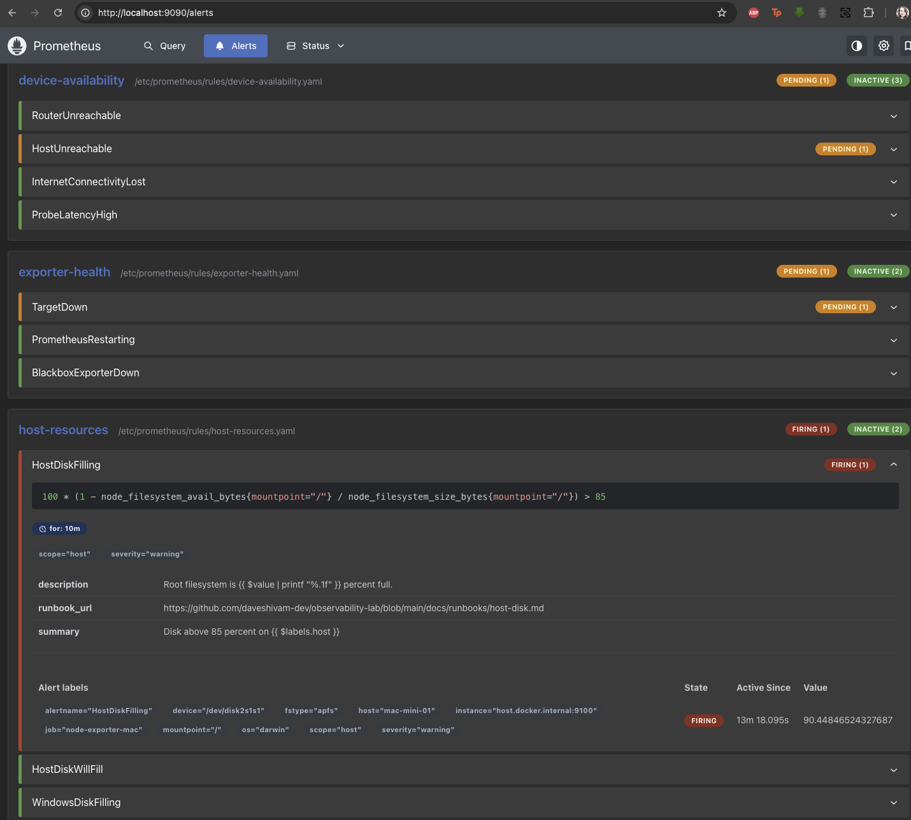
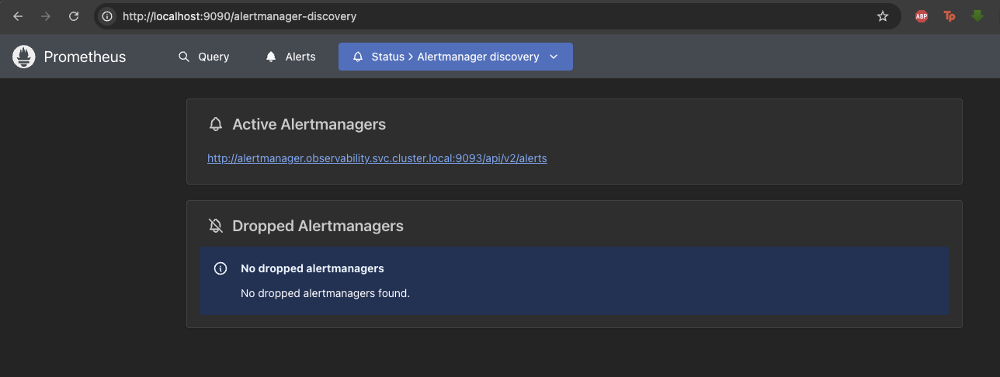
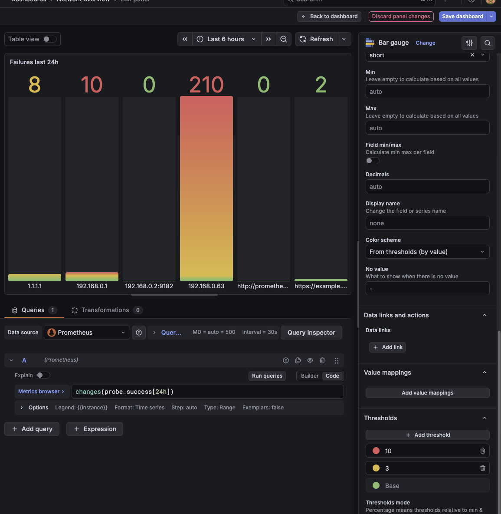

# Local observability lab

[](https://github.com/daveshivam-dev/observability-lab/actions/workflows/ci.yml)

A two node Kubernetes cluster running Prometheus, Alertmanager and Grafana,
monitoring a real home network across macOS, Windows and isolated IoT devices.
Every resource here was written directly from the API reference. No Helm
charts, no kube-prometheus-stack, so the moving parts stay visible.

Runs on Apple Silicon. Every image is verified for a `linux/arm64` variant
before use, and the reasoning behind each design choice is recorded in
[docs/decisions.md](docs/decisions.md).

## What it does

**Cluster and core stack**
- kind cluster, one control plane and one worker, reachable on the host
  through port mappings
- Prometheus scraping itself, the API server, both kubelets and cAdvisor
- Read only cluster scoped RBAC for the Prometheus ServiceAccount
- Grafana with its Prometheus datasource provisioned from a ConfigMap

**Hosts**
- `node_exporter` on the macOS host and `windows_exporter` on a Windows
  machine, both scraped from inside the cluster
- Two different answers to the same networking problem, documented in
  D-006: a Docker DNS alias for the host running the cluster, a LAN address
  for the separate machine

**Network**
- `blackbox-exporter` probing the router, both hosts, an IoT device and two
  external control endpoints over ICMP, HTTP and TCP
- The standard `relabel_configs` pattern, where the scrape target is the
  exporter and the probed address travels as `__param_target` before being
  relabelled into `instance`

**Alerting**
- Alert rules across five files in `config/prometheus/rules/`, covering
  device availability, host resources, exporter health, macOS specifics and
  the custom exporter
- Alertmanager with grouping, severity routing and three inhibition rules,
  so a failed gateway produces one notification rather than eight
- A webhook receiver that logs the payload, so delivery is verifiable with
  `kubectl logs` rather than assumed

**Dashboards and runbooks**
- Five Grafana dashboards in `dashboards/`, generated as JSON and imported,
  not assembled by hand in the UI
- Nine runbooks in `docs/runbooks/`, one per alert family, each linked from
  the `runbook_url` annotation on the rules that use it

**A custom exporter**
- `exporters/homelab-exporter/` exposes two things nothing off the shelf
  covers: device presence through the ARP table, and directory sizes
- ARP presence works where ICMP probing cannot. Eight IoT devices have
  client isolation enabled, so they never answer a ping, but layer 2
  resolution still happens before the router drops the forwarded packet
- Directory sizes exist because of an incident. An application cache reached
  127 GB with no metric moving until the volume alert fired at 85 percent

## Architecture

```
  macOS host                              Windows machine
  ├─ node_exporter :9100                  └─ windows_exporter :9182
  ├─ homelab-exporter :9220                          │
  └─ Docker ────────────────────────────┐            │
       │                                │            │
       │  kind cluster                  │            │
       │  ┌──────────────────────────┐  │            │
       │  │ namespace: observability │  │            │
       │  │                          │  │            │
       │  │  Prometheus ─────────────┼──┴────────────┘
       │  │    │  │                  │   scrapes hosts and LAN
       │  │    │  └─ blackbox-exporter ──> router, hosts, IoT, external
       │  │    │                     │
       │  │    └─> Alertmanager ─────┼──> webhook sink (logs payload)
       │  │                          │
       │  │  Grafana <─ datasource ──┘
       │  └──────────────────────────┘
       │
  NodePort 30090 -> 9090 (Prometheus), 30000 -> 3000 (Grafana)
```

Both exporters on the hosts run outside Kubernetes deliberately. They report
on the machine, and a pod sees a container's view of the world rather than
the host's. The custom exporter has a second reason: a container has its own
network namespace and therefore its own ARP table, so it would start cleanly
and report confidently on the wrong network (D-013).

## Repo layout

```
cluster/kind-config.yaml        two nodes, host port mappings
config/
  prometheus/prometheus.yml     source of truth, linted by promtool
  prometheus/rules/             alert rules, five files
  blackbox/blackbox.yml         icmp, http_2xx, tcp_connect modules
  alertmanager/alertmanager.yml routing, grouping, inhibition
  local/                        real addresses, gitignored
manifests/                      flat and numbered, applies alphabetically
scripts/render-all.sh           regenerates every ConfigMap from config/
scripts/check-sanitisation.py   fails on public IPs or real MAC addresses
.github/workflows/ci.yml        lint, test, build, scan and validate on every push
dashboards/                     five Grafana dashboards as JSON
exporters/homelab-exporter/     custom Python exporter, tests, Dockerfile
docs/
  decisions.md                  19 decisions with reasoning and dates
  sanitisation.md               what must never be committed
  runbooks/                     one per alert family
  images/
```

### The ConfigMap rendering rule

`config/prometheus/prometheus.yml` is the source of truth. It is a real
Prometheus config file, so `promtool check config` can lint it, which it
cannot do for YAML embedded in a ConfigMap's `data` block.
`manifests/11-prometheus-config.yaml` is generated from it.

```
./scripts/render-all.sh
kubectl apply -f manifests/
kubectl -n observability rollout restart deploy/prometheus
```

Edit the config, re-render, apply, restart. Never edit a rendered ConfigMap
directly, because the next render overwrites it. Applying a ConfigMap does
not restart the pods that mount it, which is a step worth knowing before it
costs a debugging round.

## Running it

```
kind create cluster --config cluster/kind-config.yaml
kubectl apply -f manifests/
kubectl -n observability get pods -w
```

Prometheus at http://localhost:9090, Grafana at http://localhost:3000.
Import the dashboards from `dashboards/` and point them at the provisioned
Prometheus datasource.

Teardown, in this order, because the kind nodes are containers backed by a
Docker disk image on an external drive:

```
kind delete cluster --name observability
```

## Alerting

Thresholds were chosen by observing the systems rather than copied:

| Alert | Threshold | Why |
|---|---|---|
| RouterUnreachable | for 2m | Everything depends on it, detect fast |
| HostUnreachable | for 5m | A host rebooting should not page anyone |
| MacDiskFilling | 85 percent for 10m | Matches the dashboard threshold so both agree |
| MacMemoryPressure | compressed > 4 GiB | macOS compresses before it swaps, so this is the earliest honest signal |
| IsolatedDeviceAbsent | for 30m | Embedded devices drop off the ARP table when idle |

Every filesystem rule is scoped with
`mountpoint=~"/System/Volumes/Data|/Volumes/.+"`. Five APFS volumes share one
container and report identical figures, so an unscoped rule fires five times
for one condition. That is easy to ship without noticing, because five alerts
for a real problem still looks like the alert working.

Inhibition, in order of usefulness:

```
RouterUnreachable     suppresses  scope=host
severity=critical     suppresses  severity=warning  (same alertname, instance)
BlackboxExporterDown  suppresses  scope=network
```

## The custom exporter

```
homelab_device_present{device,type}
homelab_device_last_seen_timestamp_seconds{device,type}
homelab_arp_devices_total{subnet}
homelab_arp_unmapped_devices
homelab_directory_size_bytes{name}
homelab_directory_present{name}
homelab_collector_last_run_timestamp_seconds
homelab_collector_duration_seconds{collector}
homelab_collector_errors_total{collector}
```

Four design choices worth defending:

**Cardinality is bounded by construction.** Devices are labelled by a name
from a config file, never by MAC. A MAC label would be unbounded, since every
visitor's phone and every randomised address becomes a permanent series, and
it would put hardware identifiers into the metric store. Unmapped devices
increment a counter and create no series. A unit test asserts that no label
value anywhere in the registry looks like a MAC address.

**Absence is represented explicitly.** Every known device emits a zero at
startup. Without it, a device absent since boot has no series at all and an
alert on `== 0` can never fire. Same reasoning for directories: a missing one
reports absent rather than size zero, because "the drive is unmounted" and
"the cache was cleaned" need opposite responses.

**An empty ARP table is an error, not a finding.** Since macOS 15, reading
the neighbour table needs Local Network permission granted per binary. One
Python interpreter returned exit code 0, no stderr and zero bytes where
another returned fifteen entries. An exporter trusting that result would
report every device absent with the error counter at zero: a confident,
precise, entirely wrong answer. A live segment always has a gateway, so the
exporter now raises instead.

**It runs on the host.** See D-013 above.

Fourteen tests, none touching the network, run with `pytest`.

## Screenshots

| | |
|---|---|
|  | Prometheus targets, all healthy |
|  | Grafana datasource provisioned from a ConfigMap |
|  | macOS and Windows memory on one graph |
|  | `probe_success` flipping to 0 |
|  | Three alert groups, one firing in each |
|  | A firing alert with annotations rendered, including the resolved runbook link |
|  | Prometheus has discovered Alertmanager |
|  | `changes(probe_success[24h])`, one device at 210 transitions |

## Sanitisation

Rules are in [docs/sanitisation.md](docs/sanitisation.md), written before the
first real address was typed into a config rather than as a cleanup pass,
because git history keeps whatever was committed.

No public addresses, no MAC addresses, no SSID, no router model with
firmware version, no hostnames identifying the household. Devices carry
generic labels. Real values live in a gitignored `config/local/`. Dashboard
JSON embeds queries, which embed labels, so exports are checked before they
are committed.

This is enforced rather than trusted. A pre-push grep caught five real MAC
addresses staged for commit in test fixtures and documentation examples,
copied from live output while writing the files. They were replaced with the
range RFC 7042 reserves for documentation. The person writing the rules is as
likely to breach them as anyone else, which is why the check is now a
blocking CI job: `scripts/check-sanitisation.py`, see below.

## Continuous integration

Every push and pull request runs four jobs in GitHub Actions
([ci.yml](.github/workflows/ci.yml)):

| Job | What it checks |
|---|---|
| sanitisation | No public IPs or real MAC addresses in any tracked file |
| exporter | `ruff check` and `pytest` for the custom exporter |
| image | Builds the exporter image, then Trivy fails the build on fixable high or critical vulnerabilities |
| config | `promtool` on the Prometheus config and alert rules, `amtool` on Alertmanager, generated ConfigMaps match their sources, `kubeconform` on every manifest |

The tools run from pinned container images rather than marketplace actions,
so each step can be run locally with the same command. Reasoning in D-019.

## Known limitations

- Storage is `emptyDir`, so a restart loses metric history and resets every
  pending alert clock
- Exporters serve plaintext with no authentication to anything on the LAN
- The Windows host is a static DHCP address with no reservation, so a lease
  change breaks the scrape
- The router has no SNMP support, so SNMP was dropped (D-011)
- Coverage is limited to what one vantage point can reach. Devices on the
  guest network are not visible at all
- The custom exporter does not autostart. launchd is denied access to the
  external volume it lives on

## What I would change for production

Persistent storage and a retention policy. Service discovery instead of
static host entries. Recording rules to normalise metric names across
platforms, because the same concept currently needs one query per OS and
every panel and alert doubles with each new platform. TLS and authentication
on the exporters. Secrets rather than plain ConfigMaps for anything
credentialed. High availability for Prometheus, which is a single point of
failure here. And a collector inside the isolated segment, so coverage is not
bounded by where the one collector happens to sit.
