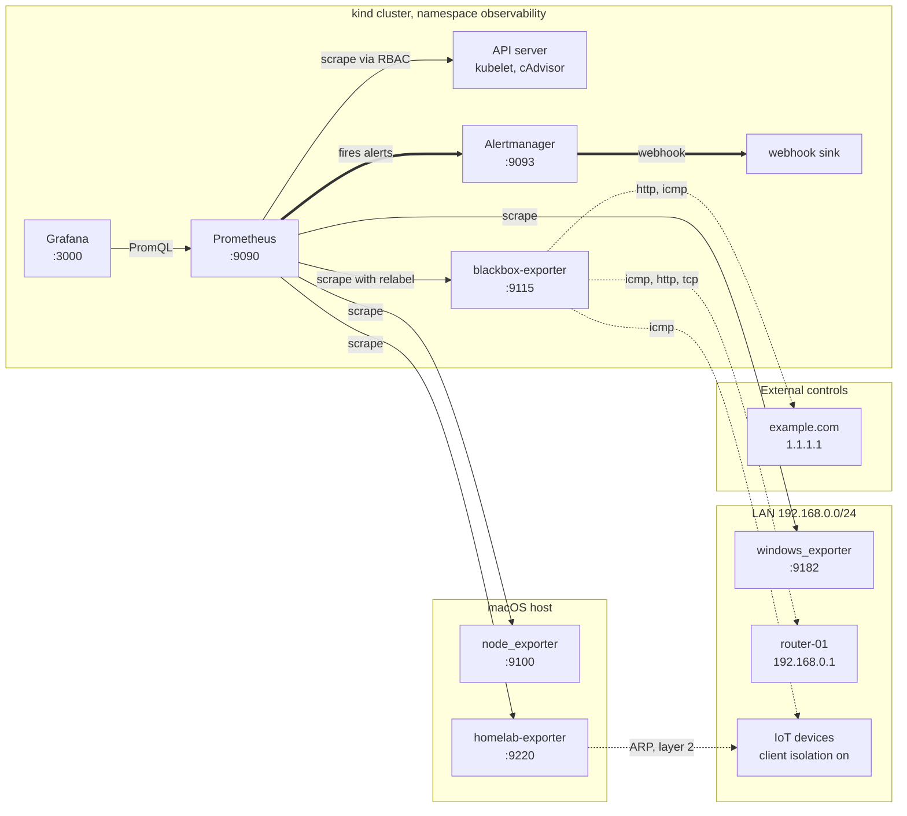

# Architecture

## The whole system



Solid arrows are scrapes, which Prometheus initiates on a timer. Dotted
arrows are probes, which an exporter performs on Prometheus's behalf when it
is scraped. Thick arrows are the alert path, which is the only flow Prometheus
pushes rather than pulls.

## The cluster boundary

Everything inside `cluster` runs as a pod. Everything outside does not, and
each case has a reason.

**node_exporter and windows_exporter** report on the machine: its CPU, memory,
disks and network interfaces. A pod sees a container's view of those, not the
host's, so running them in Kubernetes would produce confident numbers about
the wrong thing.

**homelab-exporter** has a second reason on top of the first. A container has
its own network namespace and therefore its own ARP table, which contains
cluster addresses rather than LAN ones. It would start cleanly and report on a
network nobody cares about. Recorded as D-013.

**blackbox-exporter** is the opposite case. It probes outward over the
network, so where it runs only affects which vantage point it probes from.
Inside the cluster is fine, and the pod benefits from the same RBAC and
securityContext as everything else.

## How a pod reaches the host

Two different answers to what looks like one problem:

| Target | Address | Why |
|---|---|---|
| macOS host exporters | `host.docker.internal:9100` and `:9220` | A DNS alias Docker Desktop provides for the machine running Docker. Survives DHCP changes and states the intent |
| Windows machine | `192.168.0.2:9182` | A separate device on the LAN, so the Docker alias means nothing for it |

`localhost` inside a pod is the pod. Recorded as D-006.

## The blackbox relabel pattern

The one piece of configuration worth understanding before any other.

The scrape target is the **exporter**, not the device. The address to probe
travels as a URL parameter and is then relabelled into `instance` so the
resulting series is labelled by the device rather than by the exporter:

```yaml
relabel_configs:
  - source_labels: [__address__]
    target_label: __param_target
  - source_labels: [__param_target]
    target_label: instance
  - target_label: __address__
    replacement: blackbox-exporter.observability.svc.cluster.local:9115
```

Without the second rule every probe series would carry
`instance="blackbox-exporter...:9115"` and all devices would collapse into one
series. The third rule is what redirects the scrape to the exporter after the
original address has been captured.

## Two ways to know a device is there

The network has two classes of device and they need different evidence.

**Reachable devices** are probed by blackbox over ICMP. `probe_success` is 1
when the device answers.

**Isolated devices** have client isolation enabled on the router, which is
correct security practice. They never answer ICMP, so blackbox reports them
down forever. But ARP resolution happens at layer 2, before the router decides
whether to forward anything, so they still appear in the ARP table.

```
arp -a | grep 192.168.0.48     # entry present
ping -c 2 192.168.0.48          # 100 percent loss
```

An ARP entry proves the device is on the segment. It does not prove it is
reachable. The metric is called `homelab_device_present`, not
`homelab_device_up`, because those are different facts.

## The alert path

```
rule files  ->  Prometheus evaluates every 30s
                    |
                    v
            pending (for: duration)
                    |
                    v
                 firing
                    |
                    v
            Alertmanager: group -> inhibit -> route
                    |
                    v
            webhook sink (logs the payload)
```

Grouping batches related alerts arriving together. Inhibition suppresses
symptoms when the cause is already firing: `RouterUnreachable` suppresses
every host-scoped alert, because a dead gateway makes every downstream device
unreachable by definition. Routing then sets urgency by severity.

The sink is a logging receiver rather than a paid notification service. It
makes delivery verifiable with `kubectl logs` instead of assumed, which is the
step most setups skip.

## Configuration flow

```
config/prometheus/prometheus.yml        source of truth, promtool lints it
config/prometheus/rules/*.yaml
config/blackbox/blackbox.yml
config/alertmanager/alertmanager.yml
            |
            |  ./scripts/render-all.sh
            v
manifests/11-prometheus-config.yaml     generated, never edited by hand
manifests/14-prometheus-rules.yaml
manifests/40-blackbox-configmap.yaml
manifests/33-alertmanager-configmap.yaml
            |
            |  kubectl apply -f manifests/
            v
        ConfigMaps mounted into pods
            |
            |  kubectl rollout restart
            v
        process re-reads its config
```

The config files are separate from the ConfigMaps because `promtool check
config` needs a real Prometheus config file and cannot read YAML embedded in a
`data` block. CI re-renders everything and fails if `git diff` shows a change,
which turns "never edit a rendered ConfigMap" from a rule in the README into
something a pull request cannot get past.

Applying a ConfigMap does not restart the pods that mount it. The kubelet
refreshes the file eventually, but the process does not re-read it on its own.

## Access from the host

kind maps two node ports to the host, bound to `127.0.0.1`:

```
localhost:9090  ->  NodePort 30090  ->  Prometheus
localhost:3000  ->  NodePort 30000  ->  Grafana
```

Nothing else in the cluster is reachable from outside it.

## What this design does not cover

- **One vantage point.** Everything is probed from the cluster, so devices on
  the guest network are invisible and anything the Mac cannot reach is not
  monitored. A collector inside each segment would fix it
- **Metrics only.** No logs and no traces, so the stack answers "what" and
  rarely "why"
- **No persistence.** Storage is `emptyDir`, so a restart loses metric history
  and resets every pending alert clock
- **Single Prometheus.** No federation, no high availability, so the
  monitoring system is itself a single point of failure
- **Plaintext everywhere.** The exporters serve to anything on the LAN with no
  TLS and no authentication
